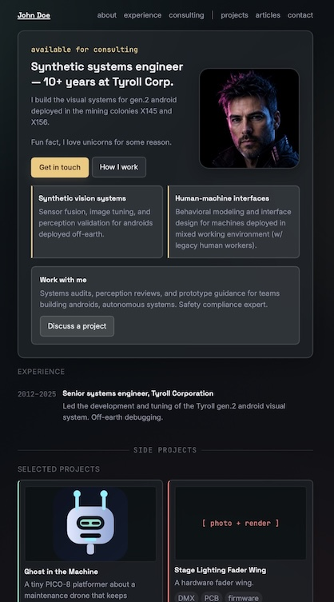
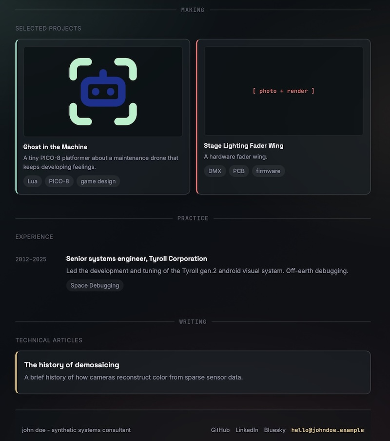

# Astro Portfolio Starter - for Indie Dev & Consultant

**Author: Gaël Jaffrain - hello@gaeljaffrain.com**

[](https://demo.gaeljaffrain.com)

## Intro

Astro portfolio site with two homepage modes: `maker` and `consulting`. The two modes include the following sections:
- hero
- selected projects
- experience
- tech articles
- contact info

Built for **Astro v7**. Requires **Node 22+**.

## Template

The visual content and sample portfolio copy intentionally use a fictional persona named John Doe. This is a template example only; the template itself is authored by Gaël Jaffrain.

This template was generated to learn how to code an Astro site, with the goal to upgrade my old Wordpress portfolio. 




## License

The source code is licensed under the MIT License. See [LICENSE](LICENSE) for details.

## Placeholder assets

The template includes some visual placeholders.

You are encouraged to replace these assets with your own artwork,
photography, branding, or other assets appropriate for your project.

See [ASSETS.md](./ASSETS.md) for provenance details.

## Run locally

```
npm install
npm run dev
```

Open http://localhost:4321

## Switch homepage mode

Set `consultingEnabled` in `src/config/site.ts`:

```ts
export const consultingEnabled = false;
```

- `false` shows the maker homepage copy.
- `true` shows the consulting copy, and the additional expertise cards, and 
"Work with me" section.


The rest of the content lives in several components in 
`src/components/`, or in plain markup files for the Projects and Articles collections.

## Edit homepage content

- title and description: update in `src/config/site.ts`
- hero copy: update `src/components/Hero.astro`
  - include the hero copy, the expertise cards, the "work with me" blurb
- experience list: `src/components/Experience.astro`
- social links in the footer: `src/components/Footer.astro`

Edit directly, this content changes rarely enough that it doesn't need its
own content collection.

## Add a project

Add a new `.md` file in `src/content/projects/`. The schema lives in
`src/content.config.ts`.

One important field in the frontmatter is `type` with 2 possible values:

- `type: software`
- `type: hardware`

While each project type has the same fields required in the frontmatter, the style is defined differently in `src/styles/global.css`.

See `pico8-game-04.md` and `dmx-cue-controller.md` for examples of each.

The markdown body of each file becomes the project's write-up. Each one lives on 
its project's own page at `/projects/<filename-without-extension>/`.

## Add a technical article

Add a new `.md` file in `src/content/articles/`.

Articles appear in the homepage's **technical articles** section and are
rendered at `/articles/<filename-without-extension>/`. The schema for
article frontmatter is defined alongside the project schema in
`src/content.config.ts`. So this is very similar to the `projects`

## Site structure

- `src/config/site.ts` — homepage mode switch.
- `src/pages/index.astro` — homepage layout and collection listings.
- `src/content/projects/` — project write-ups and project metadata.
- `src/content/articles/` — technical articles and article metadata.
- `src/content.config.ts` — Content Layer collection schemas.
- `src/components/` — shared navigation, footer, and collection cards.
- `src/layouts/Layout.astro` — shared HTML document shell and metadata.
- `public/` — static images, favicon, and other files copied unchanged to
  the build output.

## Colors

Defined once as CSS variables in `src/styles/global.css`:

- `--accent-pro` (amber) — reserved for the consulting zone only.
- `--accent-software` (teal) / `--accent-hardware` (coral) — used only
  below the "side projects" divider, to tell the two project types
  apart at a glance.

Keep that separation when you extend the site — don't let the amber
accent leak into the projects zone or vice versa; it's what makes the
two-zone structure read clearly.

## Deploy to GitHub Pages with a custom domain

1. Push this repo to GitHub.
2. In the repo settings → Pages, set the source to GitHub Actions.
3. Add a workflow at `.github/workflows/deploy.yml` using the official
   `withastro/action` (see https://docs.astro.build/en/guides/deploy/github/
   for the exact snippet — search `docs.astro.build` for "Deploy your
   Astro Site to GitHub Pages" since these steps can change).
4. Add a `public/CNAME` file containing just the website URL.
5. Point your domain's DNS at GitHub Pages per GitHub's custom-domain
   docs, then check "Enforce HTTPS" in the Pages settings once DNS
   propagates.